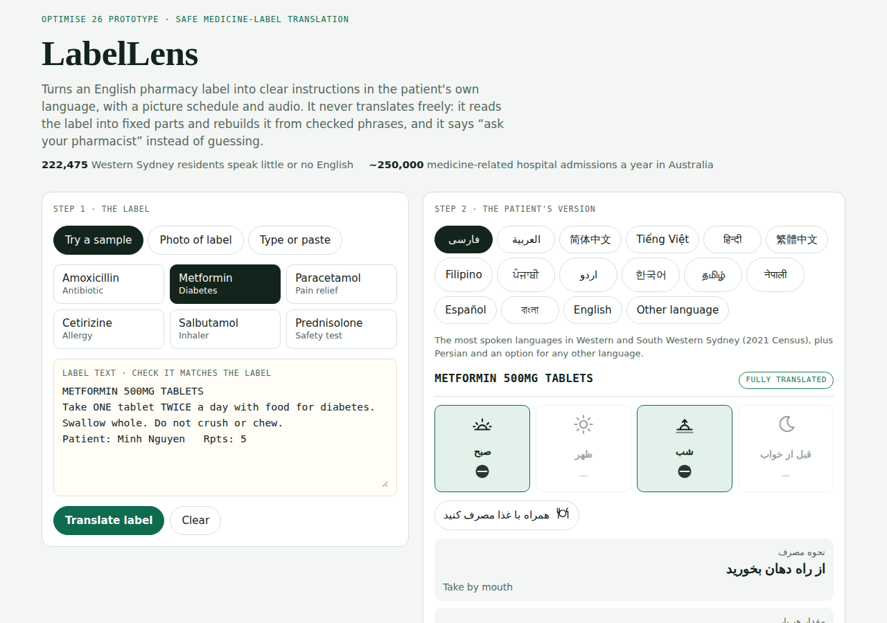

# LabelLens 💊

**Safe medicine-label translation for patients who don't read English.** It turns an English pharmacy label into clear instructions in 14 languages, with a picture schedule, audio and a check question, and refuses any label it can't translate safely.

**Live demo:** https://reihooneh.github.io/labellens/ · Built for **Optimise 26**, Western Sydney University's student project showcase.



## The problem

- About **250,000** hospital admissions a year in Australia are caused by problems with medicines, and about half are preventable (Pharmaceutical Society of Australia, 2019).
- **222,475** people in the Western Sydney area (8.5%) speak English not well or not at all (2021 Census, .id community profile).
- Free machine translation makes mistakes on medical instructions. On emergency discharge instructions, Google Translate was 94% accurate for Spanish but only **67.5% for Farsi** and 55% for Armenian (Taira et al., *J Gen Intern Med*, 2021).

## The approach: structure, not free translation

1. **Read** the label text, using on-device text recognition (Tesseract.js) or text the user types or pastes. The user always confirms the text before anything is translated.
2. **Parse** the instruction into fixed fields: route, dose, unit, how often, times of day, food, when needed, maximum dose, duration, purpose and standard warnings.
3. **Rebuild** each field from a phrase library written in advance for each language. Nothing is generated freely, so nothing can be mistranslated while the app runs.
4. **Refuse** anything outside the supported patterns, such as reducing doses, weekly medicines, "as directed" and insulin units, and show "ask your pharmacist" instead. Unusual doses are flagged.
5. **Show** a picture schedule (morning, midday, evening, bedtime), play audio where the device has a voice, and ask a check question (teach-back).

**Languages:** Arabic, Mandarin (Simplified Chinese), Vietnamese, Hindi, Cantonese (Traditional Chinese), Filipino, Punjabi, Urdu, Korean, Tamil, Nepali, Spanish, Bengali and Persian. They were chosen from 2021 Census data for the Western Sydney and South Western Sydney Local Health Districts. An **Other language** option shows the picture schedule in English, with the free TIS National interpreter line for pharmacies. Adding a language means adding one table of about 60 phrases, with no code changes.

## Features

- Photo, typed text or one of six sample labels
- 14 languages plus plain English and an "Other language" fallback, with right-to-left layout for Arabic, Persian and Urdu
- Picture schedule, audio and a check question
- Refuses unsafe or unreadable labels instead of guessing
- Works on phones, tablets and laptops, and in light and dark mode

## Run it

It is a single HTML file with no build step. Open `index.html` in a browser, or serve the folder so photo reading works (it needs `http://` or `https://`):

```bash
python3 -m http.server 8000      # then open http://localhost:8000
```

## Tests

```bash
npm install
npx playwright install chromium
npm test
```

There are 48 checks, run in a real browser:

- **Parser (31 cases):** 19 written label instructions plus text read from the 12 sample label images in `samples/` (clean and photo-like). Every case gives the expected dose, frequency, food and warnings, or is refused. Garbled text from a blurred photo is refused, not guessed.
- **Interface and safety (17 checks):** every sample renders in every language option with no missing phrases. Reducing doses, weekly medicines and "as directed" are refused, and unusual doses are flagged. Markup and script in label text never run. Layouts are checked at phone, tablet and laptop widths, and right-to-left text is checked.

CI runs the tests on every push and deploys the site to GitHub Pages only if they pass.

## Security and privacy

- **Nothing leaves the device.** Photos and label text are processed in the browser and never uploaded.
- **Label text is never treated as code.** It is always inserted with `textContent`, and the tests try script and markup injection in several languages.
- **A Content-Security-Policy** limits what the page may load: the pinned Tesseract.js release and its English language data (only when a photo is chosen) and Google Fonts. It blocks plug-ins, `<base>` tags and form posts.
- **Bounded input:** label text is limited to 4,000 characters, and anything longer is refused. Text recognition has time limits, and photos are scaled down before reading.

See [SECURITY.md](SECURITY.md) for how to report a problem.

## Limitations

- It covers the most common dose patterns on Australian dispensing labels, not every label.
- Text recognition can misread a strength (for example, 10 mg read as 100 mg). The app shows the medicine name and strength exactly as read and asks the user to check them against the label.
- **The translations are drafts until native speakers review them.** The app shows each language's review status.
- It has not been tested with patients. **It is not a medical device**, and the pharmacist always has the final say.

## Licence

MIT. See [LICENSE](LICENSE). The sample labels and patient names are made up.
